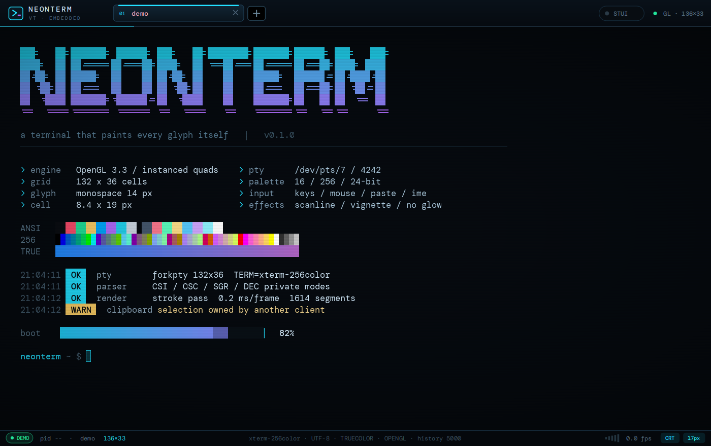
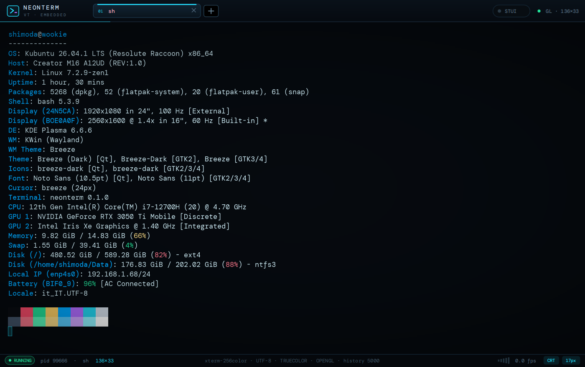
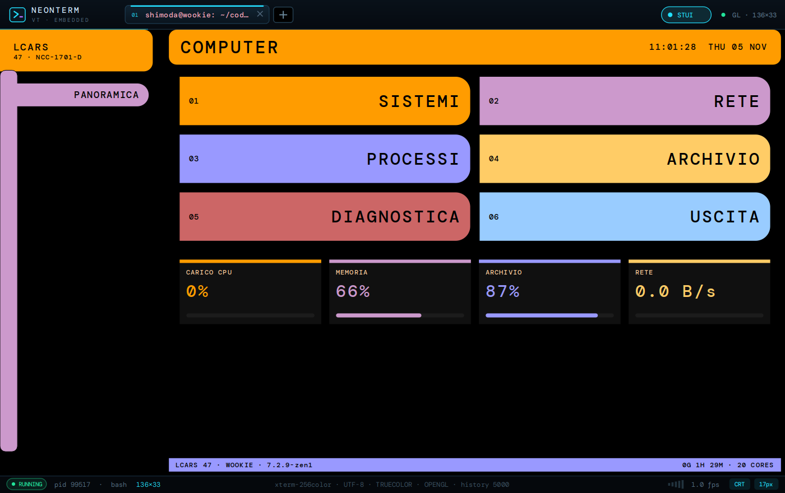

# neonterm

Terminale per Linux in C++20 + Qt 6, con **tutta la grafica disegnata a mano**
dentro l'app: niente `QTextEdit`, niente widget di sistema per il testo. La
griglia dei caratteri è renderizzata da **OpenGL 3.3 core** (istanze su GPU,
atlas di glifi, post-processing in shader); la testata, le schede e la barra di
stato restano `QPainter`. `--paint` commuta su un renderer CPU (`QPainter`)
equivalente, utile come riferimento e su macchine senza GL.

Sotto la grafica c'è un terminale vero: un pty (`forkpty`), un parser
VT100/ANSI/xterm incrementale e un buffer a celle con scrollback.

```
src/core/     Screen      buffer a celle, attributi, scroll region, alt screen
              VtParser    macchina a stati CSI/OSC/SGR, UTF-8
              Pty         forkpty + master non bloccante + TIOCSWINSZ
              Session     QObject: pty + parser + segnali (updated/title/exited)
src/ui/       TermSurface stato condiviso: sessione, griglia, selezione, tasti
              TermView    renderer CPU (QImage + QPainter)
              GlTermView  renderer OpenGL (canvas QOpenGLWidget + shader)
              NeonFont    font monolineare disegnato qui (opzione, piu' riquadri)
              HeaderBar   logo, schede, "+", readout
              StatusLine  pid, griglia, fps, badge effetti
              TermWindow  schede, scorciatoie, QSettings, menu contestuale
              Theme       palette neon, font mono
              Demo        schermata ANSI per --demo e per i test
```

## Scarica

AppImage autoconsistente per x86_64, senza installazione:

```sh
curl -LO https://cybernet.fun/neonterm/neonterm-0.1.0-x86_64.AppImage
chmod +x neonterm-0.1.0-x86_64.AppImage
./neonterm-0.1.0-x86_64.AppImage
```

Il bundle è compilato su Ubuntu 24.04, quindi la glibc minima è la 2.39
(Ubuntu 24.04, Debian 13, Fedora 40 e successivi). Pagina del progetto:
<https://cybernet.fun/neonterm/>.







## Il renderer OpenGL

- Griglia ancorata a **pixel fisici interi** (`round(cellW*dpr)/dpr`): a 1,4x di
  scala frazionaria un passo frazionario faceva ricampionare ogni glifo, ed è
  esattamente il "testo sfocato" che si vede nei terminali che disegnano testo
  in un'immagine.
- Sfondi, selezione, cursore, blocchi e braille sono **quad istanziati**; il
  testo normale sono quad istanziati che campionano l'**atlas del monospace di
  sistema**; con `--stroke-font` diventano segmenti istanziati con antialiasing
  analitico nel fragment shader (`clamp(h + 0.5 - |d|, 0, 1)`).
- Il post shader aggiunge solo scanline ogni 3 px fisici e vignettatura, e si
  spegne con `F2`. Niente alone: su un monospace a 14 px allarga i glifi e le
  lettere sembrano incollate.
- Misurato su questa macchina (Iris Xe, Mesa 26): **88–280 µs per frame** con
  1 200–1 900 segmenti di glifo, cioè il renderer è ~10× più veloce del refresh.
- La lettura dal pty è limitata a 64 kB per attivazione e ripresa con un timer
  da 4 ms: senza questo limite un figlio che scrive veloce tiene occupato il
  `QSocketNotifier` e i paint non arrivano mai.

## `show`: immagini, video, audio, pdf, txt

```
show foto.jpg            # immagine nel viewport
show film.mp4            # video con audio, frame live
show canzone.mp3         # player con waveform e avanzamento
show documento.pdf       # prima pagina (show -p 3 per un'altra)
show note.txt            # testo nel buffer, come cat
show --stop              # ferma i media in riproduzione
show -c 60 foto.jpg      # larghezza in celle
```

Il file **non viene trasferito**: `show` misura il file (QImageReader, `ffprobe`,
`pdfinfo`), chiede al terminale con `OSC 7770;show;path=…;cols=…;rows=…` di
piazzarlo alla riga corrente, e stampa le righe vuote che gli riservano lo spazio
sotto. Il terminale decodifica in locale: `MediaStore` tiene l'immagine, la pagina
PDF (`pdftoppm`) o il frame video (`QMediaPlayer` + `QVideoSink`), e per l'audio
disegna una locandina con titolo, waveform (estratta con `ffmpeg`), tempo e barra
di avanzamento. I due renderer disegnano la stessa `QImage`: con `--paint` si vede
la stessa cosa (i frame video arrivano lo stesso, il repaint è solo più pesante).

Il media è **ancorato a una riga assoluta**: scorre con il testo, sparisce quando
esce dallo scrollback (e con lui si ferma il player), e non viene ridisegnato se
non è nel viewport.

## STUI: il computer dell'Enterprise

Lo switch **STUI** in alto a destra (o `Ctrl+Shift+S`) copre il terminale con una
console LCARS: fondo nero, barre arancione/lilla/blu con un solo angolo tondo,
pill enormi, tipografia maiuscola spaziata.

È un albero, non una schermata sola:

```
COMPUTER
├── SISTEMI      CARICO · MEMORIA · CAPACITA · MONTAGGI › TABELLA/TERMICO/ENERGIA · TERMICO
├── RETE         INTERFACCE · TRAFFICO · DIAGNOSTICA
├── PROCESSI     CARICO CPU · MEMORIA
├── ARCHIVIO     CAPACITA · MONTAGGI
├── DIAGNOSTICA  PANORAMICA · SERVIZI · TERMICO
└── USCITA       TERMINALE            (torna al terminale vero)
```

Ogni livello mostra **pochi bersagli molto grandi** (2 colonne, pill da 70 px); la
colonna di sinistra ha `INDIETRO`, `PANORAMICA` e il percorso, così si risale
senza pensare. `SISTEMI › MONTAGGI › TABELLA` è già a tre livelli: la struttura
regge qualunque profondità.

Le foglie sono schermate diverse tra loro per forma — barre per core con storico,
percentuali giganti per la memoria, gauge verticali per le temperature, doppia
sparkline per il traffico, tabelle per i processi — ma tutte con la stessa
grammatica visiva. I dati vengono da `/proc` e `/sys` campionati ogni secondo:
carico per core, load average, memoria e swap, capacità dei mount, temperature
hwmon, batteria, velocità per interfaccia, top processi per CPU e RSS, kernel,
uptime. Sotto i gruppi c'è una striscia di KPI live (CPU, memoria, archivio, rete).

Il terminale resta vivo sotto: si torna indietro quando si vuole, la shell ha
continuato a girare.

## Controlli dentro un blocco media

Sotto la finestra del video compare una barra: **play/pausa** a sinistra, la
**barra di avanzamento** (si clicca e si trascina), il tempo trascorso e totale,
il **mute** a destra. In alto a destra di ogni blocco c'è la **✕** che lo toglie
dallo schermo; `Ctrl+Shift+X` li chiude tutti.

Le immagini hanno solo la ✕ (niente barra: una immagine ferma non ha trasporto).
L'audio usa la stessa barra sotto la copertina con titolo, forma d'onda e stato,
così non ci sono due barre di avanzamento sovrapposte.

I controlli sono quad disegnati dal terminale, non widget: la posizione della
barra viene calcolata una volta sola in `TermSurface::mediaUi()` e usata sia dai
due renderer sia dall'hit test del mouse, per cui il bottone che vedi è esattamente
quello che clicchi. Le immagini dei controlli (barra e ✕) sono `QImage` condivise
tra CPU e GPU, rigenerate solo quando cambia qualcosa che si vede.

## I font

Il testo normale usa il **monospace di sistema** (DM Mono su questa macchina),
rasterizzato in un atlas alla dimensione fisica esatta e disegnato come quad
istanziati: a 1,4x di scala i glifi arrivano 1:1 ai pixel, quindi restano nitidi
come in un terminale nativo. Solo i caratteri che il font non ha (CJK, emoji)
vengono aggiunti all'atlas al volo.

C'è anche un font **disegnato in casa**, `src/ui/NeonFont.cpp` — polilinee su una
griglia 6×10, accenti per composizione, box drawing, blocchi e braille — attivabile
con `--stroke-font`. A 14 px però si è rivelato poco leggibile (le 'm' sembrano
"rn", i fori si chiudono): resta come esperimento, non è il default. Il box
drawing, i blocchi e il braille vengono comunque dalle sue definizioni, perché
sono rettangoli esatti in unità di cella e a qualunque dimensione sono migliori
dei glifi scalati.

## La grafica CPU, in breve

1. Il testo viene disegnato in un `QImage` trasparente (`ARGB32_Premultiplied`)
   a dimensione fisica, una `drawText` per *run* di celle con lo stesso stile.
2. Il paint compone: gradiente di fondo → sfondi delle celle → selezione →
   media → testo nitido → cursore → scanline e vignettatura → bordo con le
   tacche d'angolo. Niente blur: il testo deve restare leggibile prima che
   "neon".

Misurato (prima della rimozione del blur): **2,5 ms per frame** a 171×42 celle
(finestra 1400×900) su questa macchina.

## Fluidità del video

I frame arrivano dal `QVideoSink` a 30 fps e vengono mostrati tutti (prima un
throttle a 45 ms ne tagliava uno su tre). Due cose rendevano la riproduzione
"lenta": il throttle e il **poster con ffmpeg sincrono** all'apertura, che
bloccava l'interfaccia per qualche centinaio di millisecondi prima del primo
frame — ora il poster viene estratto in background e il player parte subito.
`NEONTERM_DEBUG_VIDEO=1` stampa gli fps reali del sink, `NEONTERM_DEBUG_GL=1`
il costo del frame.

## Cosa supporta

- UTF-8, doppia larghezza (CJK, emoji), caratteri combinanti ignorati in modo
  sicuro, 16/256/24-bit colore, bold/dim/italic/underline/reverse/strike.
- CSI: movimento cursore, `ED/EL`, `IL/DL`, `ICH/DCH/ECH`, `SU/SD`, `DECSTBM`,
  `DECSC/DECRC`, `CHA/VPA/HPA`, `TBC`, `DSR`, `DA`, `SCS`.
- Privati: `?1` (cursor keys), `?6` (origin), `?7` (autowrap), `?25`,
  `?47/?1047/?1049` (schermo alternato), `?1000/?1002/?1003` (mouse),
  `?1006` (mouse SGR), `?2004` (bracketed paste).
- OSC 0/1/2 (titolo finestra e scheda), cursore con stile `DECSCUSR`.
- Scrollback di 5000 righe, rotella, barra di scorrimento disegnata,
  selezione col mouse con copia automatica (CLIPBOARD + PRIMARY), doppio clic
  per la parola, incolla con il tasto centrale.
- Inserimento con IME (composizione), Ctrl+lettera, Alt come prefisso ESC,
  frecce in modalità applicativa.

## Tasti

| Tasto | Azione |
|---|---|
| `Ctrl+Shift+T` | nuova scheda |
| `Ctrl+Shift+W` | chiude la scheda |
| `Ctrl+Tab` / `Ctrl+Shift+Tab` | scheda successiva / precedente |
| `Alt+1…9` | vai alla scheda |
| `Ctrl+Shift+C` / `Ctrl+Shift+V` | copia / incolla |
| `Ctrl++` `Ctrl+-` `Ctrl+0` | zoom testo, reset |
| `F2` | scanline e vignettatura on/off |
| `F11` (`Esc` per uscire) | schermo intero |

Tasto destro: menu con copia/incolla, schede, zoom, effetti.

## Riga di comando

```
neonterm [--exec "comando"] [--cwd DIR] [--demo] [--size 1240x780]
         [--font-size 14] [--no-crt] [--stroke-font] [--stui] [--stui-at PATH]
         [--capture file.png] [--write-icon DIR]
```

`--capture` rende la finestra reale in un PNG ed esce: serve per verificare la
grafica senza display (`QT_QPA_PLATFORM=offscreen`). Con OpenGL la cattura
compone il framebuffer del canvas (`grabFramebuffer`) sopra il `grab()` dei
widget dipinti a mano; `--paint` forza il renderer CPU.

## Build, test, installazione

```sh
cmake -B build -S . && cmake --build build -j"$(nproc)"
ctest --test-dir build --output-on-failure
cmake --install build --prefix ~/.local   # binario + .desktop + icone hicolor
kbuildsycoca6 --noincremental
```

Test: `test_screen` (parser e buffer, 14 casi), `test_session` (pty reale:
uscita, exit code, `stty size` dopo un resize, titolo OSC), `test_view`
(rendering offscreen, tasti verso la shell, schede, selezione, prestazioni del
paint). Girano con `QT_QPA_PLATFORM=offscreen`.

## Limiti noti

- Il contenuto **non rifluisce** quando si ridimensiona la finestra: le righe
  più lunghe vengono tagliate (solo la schermata `--demo` si ridisegna sulla
  nuova griglia). È la scelta più semplice e prevedibile per un terminale.
- Il font interno è monolineare e copre il latino: cirillico, greco, CJK ed
  emoji passano dall'atlas del font di sistema, quindi in una riga mista si
  vede il cambio di stile.
- `show` dipende dagli strumenti di sistema: `ffmpeg`/`ffprobe` per video
  (poster, waveform) e `pdftoppm` per i PDF; senza, mostra un riquadro con il
  motivo. Il video passa da Qt Multimedia, quindi serve un codec installato.
- Il media non è selezionabile né cliccabile: è un'immagine sopra la griglia.
- Come ogni protocollo di grafica inline, `OSC 7770` può essere emesso da
  qualunque processo che scriva sul tty: è lo stesso modello di sixel/kitty
  (il processo potrebbe già leggere quel file da solo).
- Nessun supporto per immagini (sixel/kitty), né per le legature dei font.
- `blink` (SGR 5) non anima il testo; il cursore invece lampeggia.
- Un solo processo per scheda: niente split pane.
